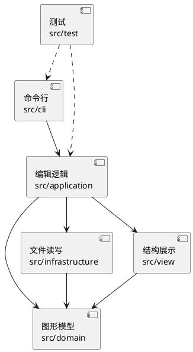

# PJ1 Phase 1：CLI SVG 编辑器项目文档

## 架构方案

### 模块划分

| 模块 | 目录 | 职责 |
|---|---|---|
| 命令行 | `src/cli` | 读取用户输入，拆分参数，找到对应命令，显示结果或错误 |
| 编辑逻辑 | `src/application` | `SvgEditor` 提供统一入口并管理当前文档；`ShapeEditingService` 负责图形编辑；`CommandHistory` 管理撤销重做 |
| 图形模型 | `src/domain` | 保存画布和图形树，处理图形行为；`ShapeProvider` 与 `ShapeFactory` 管理图形类型的创建和读回 |
| 文件读写 | `src/infrastructure` | 读取和写入文件，把 SVG 文本与图形对象互相转换 |
| 结构展示 | `src/view` | 将文档和图形格式化为 `tree/show` 的命令行文本，不修改图形 |
| 测试 | `src/test` | 检查命令结果、撤销重做、异常处理和文件往返 |

实线表示正式代码的依赖，虚线表示测试代码调用被测模块。

### 设计模式的选择

**Command（命令）模式**：每次编辑都是一个可以执行、撤销、重做的命令。`ShapeEditingService` 目前用 `SnapshotCommand` 保存编辑前后的文档，`CommandHistory` 管理历史。因此，一次 `group` 即使涉及多个图形，也只需撤销一次。撤销后再编辑会清空重做记录；`init/read/save` 和修改尺寸的 `canvas` 会清空历史，并禁止撤销重做，直到下一次编辑。`tree/show/help` 只显示信息，不进入历史。历史栈仅在 execute/undo/redo 成功后移动命令；恢复快照时先克隆目标图形，再修改当前文档。

保存整份文档副本的好处是：分组、删除等复杂操作容易完整恢复；编辑进行到一半出错，也能回到原状。代价是文档越大，每次编辑占用的内存越多。以后若要处理大型 SVG，可以保留 `CommandHistory` 和 `Command` 接口，逐条将适合的操作换成只记录必要改动的命令。新命令必须保证执行或恢复失败时不留下部分修改；历史栈不丢命令并不等于自动回滚任意新命令。

**Composite（组合）模式**：`Shape` 表示图形；矩形、圆、椭圆、线和文字是单个图形，`Group` 是能装其他图形的容器。每类图形负责自己的移动和缩放；移动或缩放容器时，`Group` 会把操作传给子图形。这样命令可以用同一种方式处理普通图形和分组。

**Factory（工厂）模式**：`ShapeFactory` 注册六种内置图形的 `ShapeProvider`，由提供者负责命令行创建和 SVG 读回。编辑器创建图形与解析器读入 SVG 共用同一工厂实例；带 `data-kind` 的 `<g>` 可匹配已注册的复合类型，没有对应提供者时按普通 `<g>` 读入。按名字选择实现仍只在两处：`CommandDispatcher` 选择命令，`ShapeFactory` 查找图形提供者。这里仅预留注册接口，没有加载外部插件，也没有实现 `box`；本阶段 `create box` 仍报未知类型。

### 依赖方向规则

1. `domain` 只依赖本模块，不需要知道命令行、文件或 XML 如何工作。
2. `infrastructure` 可以使用 `domain` 和 XML 库，不能反过来调用编辑逻辑或命令行。
3. `view` 只读取 `domain` 中的文档和图形，不参与编辑或文件读写。
4. `application` 可以使用 `domain`、`infrastructure` 和 `view`，把编辑操作、文件读写及结果展示组织起来。
5. `cli` 只通过 `application` 操作编辑器，不直接改图形树或读写 SVG。
6. 测试可以调用以上模块；正式代码不能依赖测试。

### 变化点假设与取舍

| 可能变化点 | 当前预留或不预留的理由 |
|---|---|
| 增加图形类型 | 图形行为放在 `Shape` 子类中，创建与读回由同一个 `ShapeProvider` 注册；复合类型可用普通 `<g>` 和 `data-kind` 往返。外部插件加载及真正的 `box` 语义留待后续阶段。 |
| 增加命令 | 参数处理和命令选择分别放在 `Tokenizer`、`CommandDispatcher`；命令多起来后可改成注册表，本阶段保留清楚的分发入口。 |
| 调整 SVG 读写 | 文件访问、XML 解析和序列化分开，图形模型不依赖 XML 库。 |
| 大文档的撤销成本 | 历史管理只依赖 `Command` 接口，将来可替换目前的整份文档快照。 |
| 更复杂的变换 | 本阶段直接修改图形坐标和尺寸；暂不实现 SVG 变换矩阵。 |

## 与 AI 协作的过程记录

1. 从 `Initial commit` 开始创建工作树，逐阶段开发。AI 每完成一个阶段就停下来，由我自己验收并提交。
2. AI 第一阶段只搭建工程并实现 `init/canvas/help`，第二阶段加入六种图形及 `create/tree/show`，第三阶段再实现移动、缩放、分组和撤销重做，第四阶段处理 SVG 读写。每阶段都先保证代码能运行、测试能通过，再交给我确认。
3. 实现撤销前，我让 AI 对比“每条命令自己记录反向操作”和“保存编辑前后的文档”两种办法。分组、删除会改变多个图形的位置和父子关系，前者容易漏恢复细节，因此我选择让 AI 采用快照方案。AI 编写了 `SnapshotCommand` 和相关测试，验证一次分组只占一个撤销单元。
4. AI 为 SVG 读入选择 XML 解析库，以处理嵌套标签，而不是用正则表达式硬拆 XML。编译时，AI 生成的代码把库中的 `Element` 当成浏览器 DOM 类型，造成类型不匹配；根据编译错误改用库提供的类型。读入逻辑也调整为先检查新文档，成功后才替换当前文档，并用损坏文件、重复 id 的测试验证失败时原文档和历史仍可用。
5. 我在 AI 的辅助之下对其生成的代码进行了检查，发现了一些边界之类的问题，发现的问题、改动及验证结果整理如下：
   - **文件读写**：AI 发现非零起点的 `viewBox` 在保存后会被重置，改为保留原 `viewBox` 和根属性；保存时先写临时文件再替换目标文件。无法表示的 SVG 元素或容器文本改为拒绝读入，避免悄悄丢失。
   - **命令与显示**：AI 对照示例补全 `help` 中六种 `create` 语法，让 `show` 分行显示属性，并修复文字内容 `"in"` 被误认为容器子句的问题；图形类型的创建与读回统一放进 `ShapeFactory`。
   - **输入与回滚**：AI 补上空引号、`0x10`、负尺寸和半径、带空白 id 等校验；修复极小浮点数被格式化为 0、过大变换溢出的问题。针对组内已有部分图形被改动后才失败的情况，测试确认整条命令回滚，文档和撤销历史保持可用。
6. 在功能收尾提交之后，我决定再拆分过于集中的编辑器职责。我让 AI 将 `tree/show` 的文本排版分别移到 `TreeRenderer`、`ShowRenderer`；`SvgEditor` 仍负责查找图形和报错，展示类只读模型。修改后重新运行原有命令测试，确认输出未变，并把新增的 `view` 模块和依赖方向写回架构方案。
7. 接着检查发现 `SvgEditor` 还集中了创建、分组、移动等图形编辑规则。我让 AI 将这些操作移到 `ShapeEditingService`，编辑器保留文档的创建、读写、画布尺寸、撤销重做和对外入口；服务通过当前文档的访问函数取得文档，避免 `init/read` 后仍操作旧文档。新增“重新初始化后编辑与撤销”的测试，并复跑全部测试确认行为不变。
8. 为后续图形扩展检查 `ShapeFactory` 时，发现创建和读回使用固定分支，而且编辑器与解析器各有一份工厂。我选择让 AI 将六种内置图形改为 `ShapeProvider` 注册，并让编辑器与解析器共享工厂；序列化改用图形声明的 SVG 标签。测试中临时注册一个复合图形，验证创建、移动、撤销、保存读回、缺少提供者时降级为普通 `g`，以及自动生成的子图形 id 冲突会被拒绝。这个测试类型不属于交付的内置图形，也不是题目中的 `box`。
9. 我考虑到撤销恢复也应为后续阶段做打算。检查后发现，原先 undo/redo 会先弹出历史命令，若恢复失败，该命令就会丢失；快照恢复也会先清空当前树再克隆插件图形。于是我让 AI 改成“恢复成功后再移动历史栈”“目标图形克隆成功后再替换当前树”，并用模拟恢复失败的测试验证历史和文档仍可重试。同时将树形显示标签交给图形自身：测试复合类型显示为 `g#b1 (badge)`，内置图形输出不变；虚拟画布根改用不可由 CLI 创建的空 id，不再与用户的 `__root__` 冲突。

## 实现后的一致性自查

### 模块划分

最初实现按 `cli/application/domain/infrastructure/test` 分目录。文件读写模块在第四阶段加入；后续增加的 `ShapeSummary`、`NumberFormatter`、`XmlCodec` 是模块内部辅助类。功能收尾提交后，因 `SvgEditor` 同时承担编辑与 `tree/show` 排版，新增 `src/view`，将展示职责单独拆出。图形编辑规则随后移入 `src/application/ShapeEditingService.ts`，仍属原应用层。`ShapeProvider` 和内置提供者留在 `domain`，未增加新的生产模块；上面的模块表、组件图和依赖规则已按实际结构修订。

### 依赖方向

检查代码中的 `import` 后，没有发现违反上述依赖规则的地方：图形模型不调用命令行、展示或文件读写；文件读写和结构展示分别使用图形模型；`SvgEditor` 组织编辑、读写与展示；命令行通过 `SvgEditor` 操作。按名字选择图形或命令仍集中在 `ShapeFactory`、`CommandDispatcher` 两处，与方案一致。

## 功能完整性与质量保证

### 如何确认功能完整

我按题目的命令总表逐项核对了实现：文档操作、六种图形的创建、所有编辑命令、`tree/show/help` 和撤销重做都有对应入口。然后从命令行入口运行测试，而不只单独测试图形类：检查嵌套分组、跨容器移动、属性修改、层级顺序，以及保存后重新读入能否恢复图形和属性。题目给出的典型会话也实际回放过，核对了提示符、结果反馈和结构树。`box` 在要求中明确属于后续阶段，因此本阶段检查的是它会报未知类型，而不是实现它。

题目 6.1 的两节点流程图会话整理在 `examples/flowchart.txt`，按根目录 README 的命令可直接回放，输出 `flowchart.svg`。脚本覆盖嵌套创建、`tree`、容器移动及撤销、修改文字和保存；生成后再用 `read flowchart.svg`、`tree` 检查读回结构。

### 如何确认代码质量

`npm test` 先用严格模式编译 TypeScript，再运行 30 个自动化测试，目前全部通过。除了正常操作，测试还覆盖重复 id、非法参数、损坏的 SVG、文件读写失败和组内变换中途失败等情况，检查失败后当前文档及撤销历史仍可用；读写往返测试则检查层级、文本转义、额外属性和 `viewBox` 是否保留。新增的测试用临时注册的复合图形验证扩展接口，并检查恢复失败时历史命令不丢失、文档在克隆失败时不被提前清空；暂时性的克隆失败后也能重新撤销。正式 CLI 仍只有六种内置类型。最后检查模块之间的 `import` 是否遵守上面的依赖规则，并运行 `git diff --check` 排查补丁中的空白错误。这些检查不能证明程序绝对没有缺陷，但能为本阶段功能和改动提供可重复的验证依据。

### 已知范围

只支持六种内置图形；遇到 `path` 等不支持的元素会报错。画布宽高和图形坐标读入时接受十进制数或 `px`，`viewBox` 只接受十进制数，不支持百分比等单位。读入的 `transform` 属性会保留并写回，但编辑时不会计算变换矩阵。撤销使用整份文档快照，适合本阶段的小型文档，不以大型 SVG 的性能为目标。
