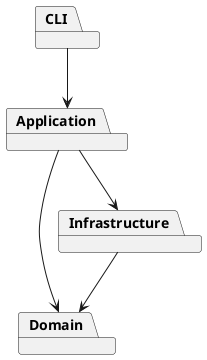

# PJ1 Phase 1 架构方案（第四阶段草案）

## 模块划分

| 模块 | 目录 | 职责 |
|---|---|---|
| CLI | `src/cli` | 提示符、带引号参数切分、命令识别和错误展示 |
| 应用层 | `src/application` | 编排编辑用例，通过 Command 历史处理撤销重做 |
| 领域层 | `src/domain` | SVG 文档、六类图形、Composite 容器树和图形工厂 |
| 基础设施 | `src/infrastructure` | SVG 文件访问、XML 解析、序列化和转义 |
| 测试 | `src/test` | 验证公开命令行为 |

依赖方向：CLI 调用应用层，应用层调用领域层并协调基础设施，基础设施可使用领域对象；领域层不依赖外层。第二阶段实现了 `Shape` 抽象类和 `Group` 容器；第三阶段把 `move/scale` 放在各图形类的多态方法中，`Group` 递归委派给子节点。编辑命令通过 `Command` 接口和 `CommandHistory` 执行，单条命令形成一个撤销单元。

当前 `SnapshotCommand` 在执行前后保存文档快照，保证 `group/ungroup/delete` 等多节点编辑可原子撤销；代价是大文档编辑会占用更多内存。新编辑清空 redo，`init/read/save` 和画布尺寸修改后历史锁定，下一次编辑后重新解锁。

第四阶段把文件访问放在 `SvgFileStore`，结构解析放在 `SvgParser`，输出放在 `SvgSerializer`。解析使用 `@xmldom/xmldom`，先构造和校验临时文档，成功后才替换当前文档。缺失 id 会先避开全文档已有 id 再自动补全；重复 id、损坏的 XML、未支持的元素会拒绝读入，避免覆盖当前编辑状态或静默丢数据。未知但合法的属性会保存在图形对象中并随文件写回，不过 CLI `set` 仍只允许规格白名单中的属性。

预计变化点是新增图形类型、命令语法、SVG 读写细节和历史实现。命令名分派集中在 `CommandDispatcher`，图形类型名分派集中在 `ShapeFactory`；这两处是计划在插件化阶段替换成注册机制的待重构点。第四阶段已实现读写；下一阶段将对照完整规格自查并补充 AI 协作记录、质量保证说明。
