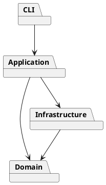

# PJ1 Phase 1 架构方案（第二阶段草案）

## 模块划分

| 模块 | 目录 | 职责 |
|---|---|---|
| CLI | `src/cli` | 提示符、带引号参数切分、命令识别和错误展示 |
| 应用层 | `src/application` | 编排文档与编辑用例；后续加入 Command 历史 |
| 领域层 | `src/domain` | SVG 文档、六类图形、Composite 容器树和图形工厂 |
| 基础设施 | `src/infrastructure`（后续阶段） | SVG 文件解析与序列化 |
| 测试 | `src/test` | 验证公开命令行为 |

依赖方向：CLI 调用应用层，应用层调用领域层并协调基础设施，基础设施可使用领域对象；领域层不依赖外层。第二阶段已实现 `Shape` 抽象类和 `Group` 容器：叶子与容器均可由 id 查找和显示，创建时可直接指定父容器。后续编辑操作将使用 Command 模式保证一条命令对应一次撤销，并把移动、缩放等行为交给图形多态实现。

预计变化点是新增图形类型、命令语法、SVG 读写细节和历史实现。命令名分派集中在 `CommandDispatcher`，图形类型名分派集中在 `ShapeFactory`；这两处是计划在插件化阶段替换成注册机制的待重构点。第二阶段实现到 `create/tree/show`，其他部分在各阶段完成后如实更新本文件，并补充 AI 协作记录、一致性自查和质量保证说明。
